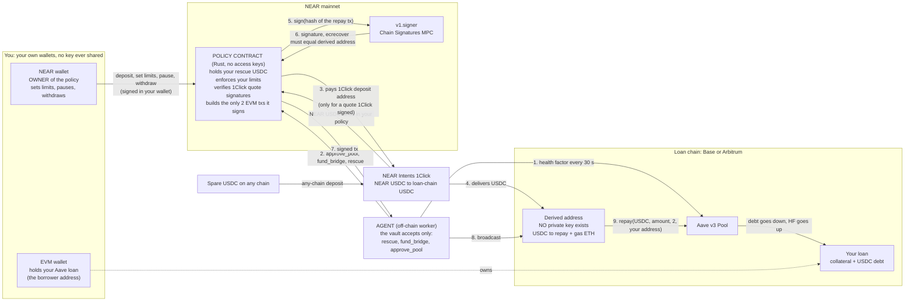
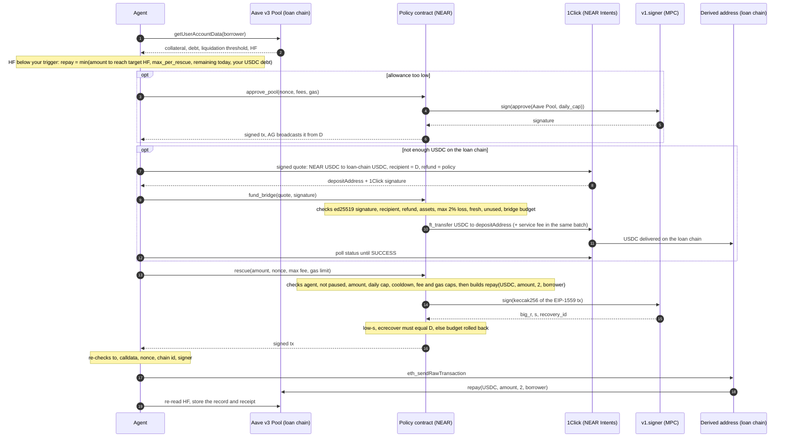

# Backstop

**Backstop pulls your money from any chain to save your loan before it gets liquidated.**

Hackathon prototype · unaudited · NEAR + Base / Arbitrum mainnet with tiny amounts

<!-- DEMO GIF: add docs/assets/demo.gif after the first mainnet rescue -->

## The problem

Your loan is on one chain. Your spare stablecoins are on another. When collateral prices fall, the
money that could save the loan is in the wrong place, and moving it by hand takes too long. On Aave,
a liquidation takes your collateral plus a bonus. Repaying a little earlier avoids that.

Bots can repay for you, but they usually hold a key that can also move your money.

## Why Backstop

- **Your loan stays yours.** It stays at your own address. Backstop never takes custody of it.
- **No key to steal.** The vault's Base address is derived from a NEAR contract with NEAR Chain Signatures, so no private key for it exists anywhere. The contract builds the only transactions it may sign.
- **Limits enforced on-chain.** Maximum per rescue, daily cap, cooldown and pause are checked by the contract, not by a bot's good behaviour.
- **Fund it from the chain you already use.** NEAR Intents moves your stablecoins across chains for you, with no manual bridge or swap.
- **Every rescue leaves a receipt.** Health factor before and after, timestamps and transaction links, in plain words.
- **Built to grow.** A new lending protocol or chain is one new adapter, not a rewrite.

## How it works

1. **Set up in your own wallets.** Connect a NEAR wallet and your EVM wallet at `/app`. You never
   type, paste or export a key: every action is a transaction you approve in your wallet.
2. **Fund it from any chain.** Deposit NEAR USDC into your **policy contract**, or send USDC/USDT
   (or other tokens 1Click swaps) from any chain 1Click supports to a one-time NEAR Intents 1Click
   deposit address. Either way the USDC lands in your policy on NEAR, where only you can withdraw it.
3. **Watch.** An agent reads the health factor (HF) of your Aave v3 loan on **Base or Arbitrum**. The loan stays at
   **your own** address.
4. **Move under your limits.** When HF falls below your trigger, the agent asks the policy to pay a
   1Click deposit address. The policy pays only for a quote **signed by 1Click** that delivers Base
   USDC to the policy's own Base address and refunds to the policy (checked on-chain, `fund_bridge`).
5. **Repay under your limits.** The policy builds the only transactions it may sign — Aave
   `repay(USDC, amount, 2, your_address)` and `approve(Aave Pool, daily_cap)` — and gets them signed
   by NEAR Chain Signatures (`v1.signer`). The agent broadcasts. Your debt drops, HF rises.

Once set up, the policy account has **no access keys**, so nobody (the operator included) can bypass its code.
The vault accepts only `rescue`, `fund_bridge` and `approve_pool` from the agent, nothing else.

### Architecture



### One rescue, in order



Inside the contract, how it uses Aave and NEAR, and failure handling: [docs/ARCHITECTURE.md](docs/ARCHITECTURE.md).

Step by step in words: [docs/site/02-how-a-rescue-works.md](docs/site/02-how-a-rescue-works.md) · security model:
[docs/SECURITY.md](docs/SECURITY.md)

## Live proof

<!-- MAINNET: fill after the keyed rehearsal run -->

| What | Link |
| --- | --- |
| Policy contract on NEAR (keyless after finalize) | Pending first mainnet run |
| Derived Base address (Basescan) | Pending first mainnet run |
| Deposit from another chain (1Click, E.9) | Pending first mainnet run |
| `fund_bridge` + 1Click swap NEAR → Base | Pending first mainnet run |
| `rescue` on NEAR, repay on Base, HF before → after | Pending first mainnet run |

Not run on mainnet yet. Verified so far, offline: a recorded **live** signed 1Click quote passes the
contract's on-chain checks and two independent TypeScript verifiers (`contracts/policy/tests/fixtures/quote.json`).

Every safety claim maps to code and a test in [docs/JUDGES.md](docs/JUDGES.md).

## Quickstart (developers)

```bash
pnpm install
cp .env.example .env          # every variable is documented there; no user keys ever go in it
pnpm test                     # TypeScript tests (all packages, agent, scripts, web)
pnpm contract:test            # policy contract unit tests (cargo)
pnpm contract:build           # policy wasm
pnpm policy:build:wsl         # Windows: builds the policy wasm in WSL Fedora (scripts/wsl-build-policy.sh)

pnpm --filter @backstop/web dev                     # site + /app on http://localhost:3000
pnpm demo --dry-run           # agent: read HF, decide, print what it would do; sends nothing, needs no keys
pnpm demo                     # agent: one pass, rescues if HF is below the contract's trigger
pnpm demo --trigger 3.0       # demo override: treat HF < 3.0 as unsafe (still capped by the contract's limits)
pnpm --filter @backstop/agent start                 # keep watching (--interval <secs>, default 30)
```

`pnpm demo` needs `POLICY_CONTRACT_ID`; a live run also needs `AGENT_ACCOUNT_ID` and
`AGENT_PRIVATE_KEY` (a function-call key limited to the agent methods).

Operator scripts (dry run by default, `--send` to broadcast):

```bash
pnpm --filter @backstop/scripts deploy-policy --name alice --owner alice.near --borrower 0x... [--rehearsal]
pnpm --filter @backstop/scripts deploy-policy --finalize alice.<deployer>.near   # rehearsal -> keyless
pnpm --filter @backstop/scripts policy status
pnpm --filter @backstop/scripts policy print pause      # near-cli-rs command the OWNER runs in their own wallet
pnpm --filter @backstop/scripts aave-setup status --address 0x...
```

Full guide: [docs/site/06-quickstart.md](docs/site/06-quickstart.md) · contract:
[contracts/policy/README.md](contracts/policy/README.md).

## Architecture

A pure risk engine in the middle, one adapter per protocol or chain around it.

```
contracts/policy                 Rust policy contract: limits, 1Click quote checks, builds + signs Base txs
packages/core                    types + risk engine (pure: repayNeeded, decideRescue)
packages/adapters/lending-aave   Aave v3: read position, oracle price, repay/approve calldata
packages/chains                  Base (viem) + NEAR (near-api-js), RPC failover
packages/signer                  Chain Signatures: derive the policy's Base address
packages/mover                   NEAR Intents 1Click: quotes, signed-quote verification, status
packages/receipts                NEAR AI Cloud receipts with template fallback
packages/db                      rescue records: rescues.json or Postgres
packages/config                  chain + protocol registry, typed .env
scripts/                         operator scripts: deploy-policy, policy status/print, derive, aave status
apps/agent                       worker + `pnpm demo`: watch, decide, bridge, rescue, broadcast, record
apps/web                         landing, /app (wallets, policy, fund from any chain), /dashboard, /docs
```

Details: [docs/ARCHITECTURE.md](docs/ARCHITECTURE.md).

## Security model

- **No user keys anywhere.** Users approve transactions in their own wallets. The policy account is
  left with no access key after setup: operator-made policies are created keyless in one transaction; self-serve
  vaults are created by your wallet with a shared setup key (one key for every vault) that the bot removes in the same transaction that
  deploys the policy (code written and unit-tested, not run on mainnet). Details: [docs/ARCHITECTURE.md](docs/ARCHITECTURE.md).
- **The contract builds every Base transaction.** `to`, `value = 0`, calldata, chain id; the agent
  only picks nonce and fees, under on-chain caps. The signature is ecrecovered against the policy's
  Base address before it is returned.
- **The contract checks every bridge.** ed25519 signature of 1Click over the exact quote, recipient
  = the policy's Base address, refund = the policy, USDC → Base USDC, at most 2% loss, fresh, unused,
  unknown fields rejected.
- **On-chain limits:** pause, max per rescue, UTC-day cap (rescues and bridges separately),
  cooldowns, fee and gas caps. Withdrawals go only to the owner and work while paused.
- **Worst case with a stolen agent key** (the vault accepts only the three agent methods, so this holds for any key type): early repayment of your own debt and shuttling up to
  `daily_cap` per day to your policy's Base address, losing at most ~2% of each bridge to fees.
  Not theft of principal.

Full model, residual risks and the security review: [docs/SECURITY.md](docs/SECURITY.md).

## Fee

Backstop charges **0.10% of each amount it bridges** (10 bps), nothing else: no deposit, withdrawal or
monitoring fee, and nothing when USDC is already at the policy's Base address. The fee is paid in NEAR
USDC to a fixed account in the same atomic batch that pays 1Click, counts against nothing you can't see
(shown in the review screen and `get_config`), is fixed when the policy is created and capped by the
contract at 0.50%. It is charged on top of the bridged amount and is **not** counted against
`daily_cap` or `max_per_rescue`, so the most that can leave per day is `daily_cap` plus 0.50% of it. Examples: $10 bridged = $0.01, $1,000 = $1. It is not refunded if 1Click refunds the
swap. Tests: `bridge_pays_the_service_fee_*`, `the_fee_rate_is_capped_at_50_bps_*`.

## Limits and risks

- Hackathon prototype, unaudited, not yet run on mainnet. Use tiny amounts.
- Beta and unaudited: vault creation is invite-only for now.
- The trigger is not enforced on-chain (NEAR cannot see the Base HF); the limits are.
- A rescue that needs a bridge takes about a minute; a faster crash can liquidate first. USDC
  already at the policy's Base address removes the bridge from the critical path.
- The policy is immutable. If 1Click or Aave change their interfaces, bridging or repaying stops;
  your funds stay withdrawable. About 2.8 NEAR of code storage is held by each policy; the owner
  gets it back with `close` (paused, an hour after the last request, USDC withdrawn). See R8 and R11 in
  [docs/SECURITY.md](docs/SECURITY.md).
- USDC at the policy's Base address can leave only as a repayment (no sweep yet).
- If the agent is offline, nothing is rescued. Your money stays in the vault; you can pause or withdraw.
- One bot account can serve many vaults, so its key reaches all of them, still only through the three agent
  methods and inside each owner's limits. One scoped key per vault is on the roadmap.
- Repays USDC variable debt on Aave v3 on Base and Arbitrum (one policy per user and chain).

More: [docs/site/07-risks-and-limits.md](docs/site/07-risks-and-limits.md).

## Roadmap

1. Backstop rescue — this prototype.
2. Owner controls from any chain through Aurora Intents Connect, once it supports NEAR as a destination.
3. Unified risk view across chains; more lending adapters (Morpho, Solana) — not built yet.
4. Automatic rebalancing; cross-margin account with a liquidity vault — not built yet.

More: [docs/litepaper.md](docs/litepaper.md) · [docs/site/08-roadmap.md](docs/site/08-roadmap.md).

## Tracks

- Unstoppable DeFi
- AI Security & Defense
- Agent Economy

## Built with

- [NEAR Chain Signatures](https://docs.near.org/chain-abstraction/chain-signatures) (`v1.signer`)
  and [chainsig.js](https://github.com/NearDeFi/chainsig.js)
- [NEAR Intents 1Click](https://docs.near-intents.org) (bridging and any-chain deposits)
- [NEAR Connect](https://github.com/hot-dao/near-selector) and [wagmi](https://wagmi.sh) for wallets
- [omni-transaction-rs](https://github.com/near/omni-transaction-rs) and near-sdk (Rust)
- [Aave v3](https://aave.com/docs) and [aave-address-book](https://github.com/aave-dao/aave-address-book)
- [NEAR AI Cloud](https://docs.near.ai)
- [Base](https://docs.base.org), viem, near-api-js, zod, drizzle-orm, Next.js, pnpm + Turborepo
