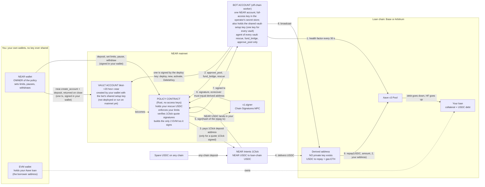
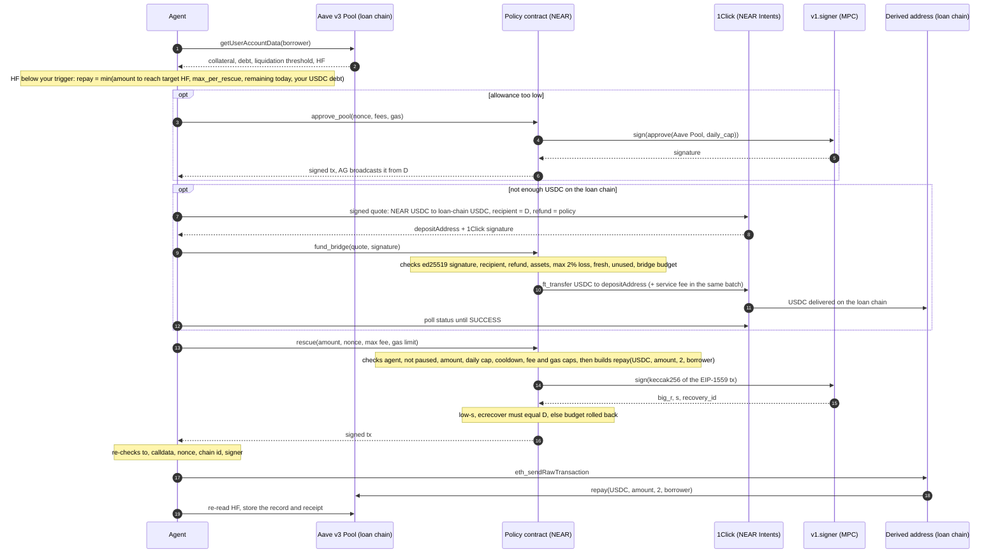
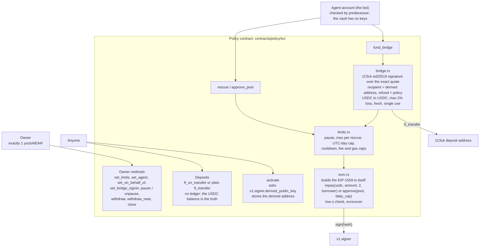

# Architecture (v2 + factory-less vault creation, not deployed)

Backstop keeps a user's rescue USDC in a **NEAR policy contract** (a vault) that has no access keys once it is set up, watches the user's Aave
v3 loan on Base, and when the health factor falls below the trigger, bridges USDC to a Base address
the policy controls (Chain Signatures) and repays the loan **on behalf of** the user's own address.
The policy builds and checks every transaction it pays or signs. Security: [SECURITY.md](SECURITY.md). Claims → tests: [JUDGES.md](JUDGES.md).

## Diagrams

### The whole system



Numbers 1-9 follow one rescue. Trust zones: the policy contract (limits, signing) and the NEAR MPC signer are on-chain; the bot is a thin, replaceable worker whose one account is the agent of every vault and can call only three methods on each; the derived address has no private key.

### One rescue, in order



The two `opt` blocks are skipped when they are not needed (allowance already set, USDC already on the loan chain). If a bridge fails, the agent still repays with whatever USDC is already there.

### Inside the policy contract



## How Backstop uses Aave

| What | How | Where |
| --- | --- | --- |
| Pool address | Never hardcoded: `AaveV3Base` / `AaveV3Arbitrum` from `@bgd-labs/aave-address-book`, stored in the policy at creation and re-checked by the agent and the web | `packages/config/src/registry.ts` |
| Health factor | `Pool.getUserAccountData(borrower)` every 30 s: collateral, debt, liquidation threshold, HF (1e18) | `packages/adapters/lending-aave/src/read.ts` |
| USDC price and debt | Price from the Pool's own oracle (`ADDRESSES_PROVIDER().getPriceOracle()`); debt from the USDC variable-debt token `balanceOf(borrower)` | same |
| How much to repay | Exact integer formula, rounded up, so repaying that amount reaches the target HF | `packages/core/src/risk.ts` |
| The repay | `Pool.repay(USDC, amount, 2, borrower)`: Aave lets anyone repay **on behalf of** a borrower, so the loan never moves and the derived address never owns the position | built in `contracts/policy/src/evm.rs` |
| The allowance | `USDC.approve(Pool, daily_cap)`: exact amount, never unlimited, once an hour | `approve_pool` |
| Arbitrum | Aave's `USDC` there is the bridged USDC.e; Backstop uses the native-USDC market (`USDCn`) that 1Click delivers | registry, tests in `apps/agent/test/checks.test.ts` |

## How Backstop uses NEAR

| What | How |
| --- | --- |
| Policy contract (vault) | Rust near-sdk 5.30, one per user and loan chain, with **no access key after setup**, so nobody can bypass its code or upgrade it. Operator-made vaults: one transaction (create account, deploy, init, activate, no `AddKey`). Self-serve vaults: see the next section |
| Vault creation | No factory contract. The user's wallet creates the vault account with `near.create_account`; the bot deploys the policy into it and deletes its own key in one transaction. See the next section |
| Chain Signatures | The policy calls `v1.signer.sign` with a 32-byte hash (`payload_v2.Ecdsa`, path `backstop-base-1`, domain 0). The signer derives a key from (policy account, path), so the EVM address is controlled by the policy's code alone. `activate` reads the address from `v1.signer.derived_public_key`, and the agent re-derives it two other ways |
| Owner vs agent | Owner methods need exactly 1 yoctoNEAR, which a function-call key cannot attach. The agent is a NEAR account (the bot account for self-serve vaults, with a full-access key held in the operator's secret store). Each vault accepts `rescue`, `fund_bridge` and `approve_pool` only from its agent account |
| NEAR Intents (1Click) | Funds enter from any chain via a deposit address; the policy pays 1Click only for a quote 1Click signed, verified on-chain with `env::ed25519_verify` |
| NEP-141 / NEP-297 | USDC is the NEAR native USDC token; every state change emits a NEP-297 `EVENT_JSON` log |
| NEAR AI Cloud | Short human-readable rescue receipt; a template is used if it is down, and it never blocks a rescue |

## Self-serve vaults, factory-less (code written, not deployed)

There is no factory contract. A vault is a top-level account `bkst-<20 hex>.near`, created in two steps.

1. **The user's wallet signs one small transaction** to the `near` registrar:
   `create_account({new_account_id, new_public_key})`, where `new_public_key` is the bot's **deploy public
   key** (`NEXT_PUBLIC_VAULT_DEPLOYER_PK`). It attaches the deposit from `vaultCreateDeposit`
   (`packages/config/src/vault-plan.ts`): code storage 276,925 B x 1e19 yocto/B = 2.77 NEAR, plus 0.05 NEAR
   state margin, 0.10 NEAR spare, the USDC storage registration and a 0.02 NEAR gas reserve; about 2.95 NEAR
   in total (computed from the constants; the exact figure depends on the wasm size and the USDC storage
   deposit). The site holds no key and signs nothing.
2. **The bot deploys.** The bot service holds the matching shared setup key (`VAULT_DEPLOYER_PRIVATE_KEY`). In ONE
   transaction signed by that key on the vault account it runs `DeployContract` (the policy wasm, whose
   sha256 must equal the pinned `POLICY_CODE_HASH`, `21ade4c3...612ebf`), `new` (owner = the user, agent =
   the bot), `activate`, and `DeleteKey` of the deploy key. The actions are atomic, and the account ends with
   no access key. The USDC storage registration is a separate earlier call from the same key.

**The name commits to the arguments.** The name is `bkst-` + the first 20 hex of sha256 over (owner, chain,
borrower, limits, salt), see `packages/core/src/vault-name.ts`. The site, the API and the bot recompute it
and refuse a request whose fields do not hash to the account id, so nobody can change the owner, loan
address or limits after the wallet signed. The salt is random per create.

**Request flow.** The browser posts the fields to `apps/web/app/api/vaults/`, which stores a request
(`packages/db/src/vault-requests.ts`; statuses pending, deploying, ready, failed, aborted). The bot
(`apps/agent/src/vault-creator.ts`) re-checks the commitment, the chain, the checksummed loan address, the
limits, and that the account has no code, exactly the deploy key and at least the creation deposit; it then
deploys and runs the same admission check as for every vault.

**Failure and refund.** Failed attempts are counted. After 3, if the deploy key is still on the account, the
bot deletes the account with the owner as beneficiary, so the owner gets the NEAR back. Once the deploy key
is gone the bot can return nothing, and the request is marked failed.

**Close.** `close` deletes the vault and sends all its NEAR to the owner: the deposit comes back minus the
deploy gas, estimated at 0.01-0.03 NEAR (not measured).

**Operator cost.** No factory to deploy, so the earlier 4.86 NEAR estimate no longer applies. The bot account
needs about 2 NEAR for gas (an estimate). Users pay for their own vault storage.

**One bot for every vault.** Each vault names the bot account as its agent. The bot discovers vaults from the
database (requests marked ready) plus `POLICY_CONTRACT_IDS`, and refuses any vault whose code hash is not
`POLICY_CODE_HASH`, whose agent is not the bot, or whose config does not match the registry. The agent
refuses to start without `POLICY_CODE_HASH` (or a factory id, for the old design). It runs the same pass per vault, with one lock per
vault and one submit queue per NEAR key.

**Status:** written and unit-tested locally. Not deployed, not run on mainnet, not tried with real wallets.

### Windows build

On Windows, `pnpm policy:build:wsl` builds the policy wasm inside WSL Fedora
(`scripts/wsl-build-policy.sh`), the same steps as `pnpm policy:build`.

## Status

| Part | Path | State |
| --- | --- | --- |
| Policy contract v2 | [`contracts/policy`](../contracts/policy) | Built; 151 unit tests; clippy clean; wasm 277 KB (`--cfg near` + wasm-opt) |
| Factory-less vault creation | `packages/core/src/vault-name.ts`, `packages/config/src/vault-plan.ts`, `packages/db/src/vault-requests.ts`, `apps/agent/src/vault-creator.ts`, `apps/web/app/api/vaults/` | Code written and unit-tested locally; **not deployed**; not run on mainnet; wallets not tested. The earlier `contracts/factory` is no longer the plan and was never deployed |
| Packages | [`packages/*`](../packages) | Built and tested |
| Agent v2 | [`apps/agent`](../apps/agent) | Built; tested with fakes; not run on mainnet |
| Multi-vault bot service | [`apps/agent`](../apps/agent) | Code written; one bot account for every vault; not run on mainnet |
| Web | [`apps/web`](../apps/web) | Landing, `/app`, `/dashboard`, `/docs`, fund-from-any-chain routes; not tested with real wallets |
| Operator scripts | [`scripts/src`](../scripts/src) | `deploy-policy` (keyless, `--rehearsal`, `--redeploy`, `--finalize`), `policy status/print`, `derive`, `aave-setup status` |
| Mainnet rehearsal | — | Pending |

## The parts

### 1. Policy contract (NEAR, Rust) — `contracts/policy`

One per vault (one per user and loan chain), created with no access keys. State: owner, agent, borrower
(`on_behalf_of`), derived `base_address` (computed on-chain by `activate` from
`v1.signer.derived_public_key`), chain id, Aave Pool, USDC on Base and NEAR, 1Click destination asset and
quote key, limits, rescue and bridge budgets, pending signatures and bridges, used quote hashes.

- **Deposits:** any sender may send USDC (`ft_transfer_call` or plain `ft_transfer`). No ledger.
- **Owner:** `set_limits`, `set_agent`, `set_on_behalf_of`, `set_bridge_signer`, `unpause`,
  `withdraw`, `withdraw_near` (1 yoctoNEAR each), `pause` (no deposit).
- **Agent:** `fund_bridge(quote, signature)` pays a 1Click deposit address after verifying the
  quote ([`bridge.rs`](../contracts/policy/src/bridge.rs)); `rescue(...)` and `approve_pool(...)`
  build a Base tx ([`evm.rs`](../contracts/policy/src/evm.rs)), reserve budget, call `v1.signer.sign`
  and return the signed tx from `on_signed` after ecrecover against `base_address`.

### 2. Agent (TypeScript) — `apps/agent`

`cli.ts` checks at startup that the policy is keyless, activated, and its config and derived
address match the registry and two independent derivations. Each pass (`rescue.ts` `runOnce`):

1. Read limits/status from the policy; HF, debt and USDC price for the borrower from Aave.
2. Decide with the pure risk engine (`packages/core`).
3. If the allowance is low: `approve_pool`, verify, broadcast.
4. If USDC on Base is short: resume a bridge still in flight, else `bridgeQuote` (non-dry
   `EXACT_INPUT` 1Click quote, verified locally) → `fund_bridge` → submit deposit → poll status.
   A bridge problem never stops a repay with what is already on Base.
5. `rescue` → verify the signed tx (kind, to, data, nonce, hash, signer) → store it → broadcast
   with retries → wait → re-read HF → record + receipt.

A signed repay that could not be broadcast stays resumable (`resumeSignedRepay`, at startup and
before every watch pass) while its nonce is current. `--dry-run` sends nothing and needs no keys.
The multi-vault service runs the same pass per vault, with one lock per vault and one
submit queue per NEAR key.

### 3. Packages — `packages/*`

| Package | Role |
| --- | --- |
| `core` | Types and the pure risk engine (`repayNeeded`, `decideRescue`). |
| `adapters/lending-aave` | Aave v3 reads (position, oracle price, USDC variable debt) and calldata. |
| `mover` | 1Click: assets, quotes, signed-quote canonicalisation and verification (same checks as the contract), deposit submit, status. |
| `chains` | viem Base client with fallback; near-api-js provider with failover (definitive errors returned at once). |
| `signer` | Derive the policy's Base address with chainsig.js and via the `v1.signer` view. |
| `db` | Rescue records: `rescues.json` or Postgres (Drizzle) when `DATABASE_URL` is set. |
| `receipts` | NEAR AI Cloud receipt text with a template fallback; never blocks a rescue. |
| `config` | Chain and protocol registry (addresses from official sources), typed `.env`. |

### 4. Web — `apps/web`

Next.js 16. Landing and `/docs` ship no wallet code. `/app` loads NEAR Connect (NEAR wallets, incl.
"Ethereum Wallets") and wagmi (EVM wallets). Steps: connect NEAR → connect EVM → find and verify the
policy → deposit (from NEAR, or **from another chain** via `/api/fund/quote` + `/api/fund/status`)
→ gas on Base → manage. Every action goes through one review dialog and one wallet prompt. Server
routes hold no keys except an optional 1Click API key. The create-vault flow signs one `near.create_account` in the wallet and posts the fields to `/api/vaults`; the
server refuses a request whose fields do not hash to the vault name.

## Repay formula

From [`packages/core/src/risk.ts`](../packages/core/src/risk.ts) (`repayNeeded`), verbatim:

```
USDC (6 decimals) to repay so the health factor reaches `targetHfBps`.

Aave v3: HF = (totalCollateralBase * liqThresholdBps / 10000) / totalDebtBase,
all "Base" values are USD with 8 decimals.

Repaying R (in base units) lowers debt. Target HF_t requires
  debt' = collateral * LT / HF_t
so
  R = debt - collateral * LT / HF_t            (clamped at >= 0)
  amountUsdc = ceil(R * 10^6 / usdcPriceBase)

With HF_t = targetHfBps / 10000 and LT in bps the bps factors cancel:
  R = debt - collateral * LT_bps / targetHfBps
  amountUsdc = ceil((debt * targetHfBps - collateral * LT_bps) * 10^6 / (targetHfBps * usdcPriceBase))
Everything is bigint and the division is done once, rounding UP, so repaying `amountUsdc`
always reaches the target and repaying one unit (0.000001 USDC) less does not.
```

`decideRescue` then applies, in order: no debt → none; HF ≥ trigger → none; paused → blocked;
cooldown → blocked; daily cap used up → blocked; otherwise rescue
`min(needed, maxPerRescue, remainingToday)`. The contract enforces the same limits again on-chain;
the off-chain check only avoids asking for a rescue that would be rejected.

## Failure handling

| Failure | What happens |
| --- | --- |
| 1Click down or quote rejected | No bridge; repay with the USDC already on Base (partial repay), or skip. `ERR_QUOTE_*` turns bridging off for the run. |
| Bridge refunded | USDC returns to the policy on NEAR; recorded as failed. |
| Bridge in flight when the agent restarts | Resumed from `get_status().last_bridge`, not quoted again. |
| MPC signing fails | Budget rolled back; agent's NEAR tx fails visibly. |
| Base RPC fails on broadcast | Retried in the pass; the signed repay stays resumable; a signed approve is re-sent. |
| Bot account out of NEAR | Every vault's agent calls fail visibly until it is topped up; no funds move. Low-balance alert planned. |
| Owner pauses | Rescues, bridges and agent approvals stop; withdrawals still work. |
